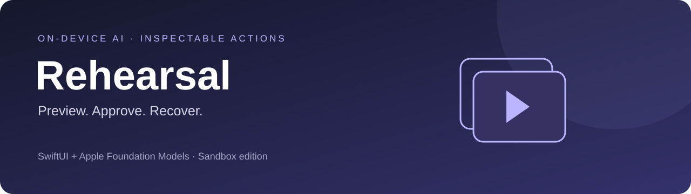
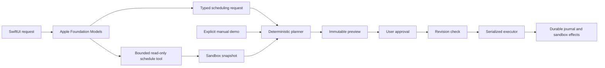

<p align="center"></p>

# Rehearsal

**An Apple Foundation Models integration exploring dependable, on-device AI actions.**

Rehearsal turns a focus-time request into a scheduling preview. You review the exact
time and reminder, approve the proposal, and explicitly execute it. A durable local
journal demonstrates what happens when the schedule changes or execution stops
halfway through.

**v0.1 is a sandbox application.** It writes simulated events and reminders to its
own journal. It does not read or modify your system Calendar or Reminders.

## Why build it?

“Schedule time for me” is an established feature. The engineering question here is:
**what binds a person's approval to the actions actually executed, especially after
state changes or an interruption?**

Siri, Shortcuts, Reclaim, and existing agent libraries cover substantial parts of
this space. Rehearsal claims no invention of scheduling, approval previews, tool
calling, or retry handling. Its contribution is a small, inspectable implementation
of these boundaries, backed by failure scenarios. See [prior art](docs/PRIOR_ART.md).

## See the behavior

```text
Request: 90 minutes between 13:00 and 17:00; reminder 15 minutes before
Busy:    lunch 12:00–13:00, appointment 14:00–15:00
Preview: 15:00–16:30, reminder at 14:45

Execute before approval      → blocked; zero writes
Approve, then change schedule → stale; zero writes
Interrupt after event write  → retry reconciles the saved event
Retry a completed proposal   → same receipts; no extra sandbox effects
```

## Apple integration: what is real?

The application includes a real, availability-gated integration with Apple's
**Foundation Models framework**:

- `SystemLanguageModel.default` checks model availability.
- `LanguageModelSession` interprets a bounded text request.
- `@Generable` and `@Guide` produce a typed request with explicit fields.
- A read-only `Tool` exposes busy intervals, with a three-call budget.
- Deterministic Swift code selects the slot and validates constraints.
- The model receives no write tools and cannot approve or execute proposals.

See [ApplePlanner.swift](Sources/RehearsalApp/ApplePlanner.swift).
**No Apple model API key or `.env` file is required for on-device inference.**
The model is supplied by the operating system; this repository does not distribute
model weights or claim to have trained an Apple model.

The manual demo makes no model calls and is explicitly labeled. It is not a
fallback that impersonates Apple Intelligence. The live model path requires a
compatible device, OS 26+, Apple Intelligence availability, and an Xcode 26+
(Swift 6.2+) build. Region, language, and model readiness also affect availability.

**Validation status:** the development machine is an Intel Mac on macOS 13 with
Swift 5.8. Live Apple-model inference and physical iPhone behavior have not been
measured. CI compiles the modern integration; compilation does not establish model
quality. See [validation](docs/VALIDATION.md).

## Run locally

On a Mac with full Xcode installed and its developer directory selected:

```sh
swift test
swift run rehearsal-demo
swift run RehearsalApp
```

The package has no external dependencies. The manual macOS app targets macOS 13+;
Apple inference requires the newer environment described above.

If SwiftPM reports `unable to lookup item 'PlatformPath'`, it is using a Command
Line Tools installation without the full platform. Select your installed Xcode,
or use the direct compiler demo:

```sh
bash scripts/direct-demo.sh
```

For iPhone, [generate the Xcode project and build the app](docs/IOS_SETUP.md).
The iOS configuration is supplied; device installation is not a published release.

## Try the native app

1. Choose tomorrow and preview the manual 90-minute focus block.
2. Review the title, date, timezone, start/end, and reminder time.
3. Approve, then execute. These are separate controls.
4. For a failure scenario, enable **Simulate reminder failure**, execute, disable
   it, and retry. The saved focus block is reused.
5. For stale approval, preview a new proposal and choose **Add conflict**, then
   try to approve or execute it. Generate a new preview to continue.

The sandbox is seeded once with tomorrow's lunch and appointment. The journal
persists across launches; subsequent dates are not automatically seeded. Runtime
data lives in Application Support under `Rehearsal/journal.json`, outside the repo.
Deleting that file resets the demo and permanently removes its local history.

## Architecture



| Boundary | Implementation |
| --- | --- |
| Model → request | Typed generation, field validation, unsupported-request clarification |
| Request → schedule | Wall-clock window, interval overlap checks, duration and reminder validation |
| Preview → approval | Immutable proposal fields and exact proposal ID |
| Approval → execution | Schedule revision checked again before the first effect |
| Interrupted write → retry | Stable operation keys and reconciliation against saved sandbox effects |
| Concurrent calls | One actor serializes mutations within one journal instance |
| Persistence failure | In-memory state advances only after file replacement succeeds |

Read [architecture and guarantees](docs/ARCHITECTURE.md) and
[privacy and security](SECURITY.md) before extending the executor.

## Initial scope and limits

- One focus block and one reminder on an explicitly selected day.
- Manual mode uses 13:00–17:00 and a 15-minute reminder lead.
- Apple mode extracts those fields from your text; manual fields do not override it.
- Ambiguous or unsupported requests are intended to request clarification. This
  behavior needs real-model evaluation; typed output alone does not prove semantic correctness.
- No EventKit adapter, Siri/App Intents integration, cloud inference, or autonomous execution.
- No cross-process locking, tamper-proof approvals, external exactly-once guarantee,
  general workflow engine, or atomic multi-service transaction.
- Earlier OS/toolchain builds deliberately compile out the Apple integration.

## Development roadmap

1. Record real-device model results against the [evaluation cases](docs/model-evaluation.json).
2. Add explicit time-window controls and a richer proposal comparison UI.
3. Introduce an EventKit adapter with permission handling, external-write reconciliation,
   and clear partial-completion semantics.
4. Add App Intents for selected app actions after the executor is validated.

## Repository guide

- `Sources/RehearsalCore` — planner, approval lifecycle, durable sandbox executor
- `Sources/RehearsalApp` — native UI and Apple Foundation Models integration
- `Sources/RehearsalDemo` — deterministic failure-and-recovery demonstration
- `Tests/RehearsalCoreTests` — behavioral regression tests
- `docs` — architecture, prior art, setup, and evaluation protocol

Built by [Sharath Chandra](https://github.com/sharath559). Independent project;
not affiliated with or endorsed by Apple. [MIT license](LICENSE).

## Primary references

- [Apple Foundation Models](https://developer.apple.com/foundation-models-framework/)
- [Guided generation](https://developer.apple.com/documentation/foundationmodels/generating-swift-data-structures-with-guided-generation)
- [Tool calling](https://developer.apple.com/documentation/foundationmodels/expanding-generation-with-tool-calling)
- [Model availability](https://developer.apple.com/documentation/foundationmodels/generating-content-and-performing-tasks-with-foundation-models)
- [Apple ToolSandbox research](https://machinelearning.apple.com/research/toolsandbox-stateful-conversational-llm-benchmark)
