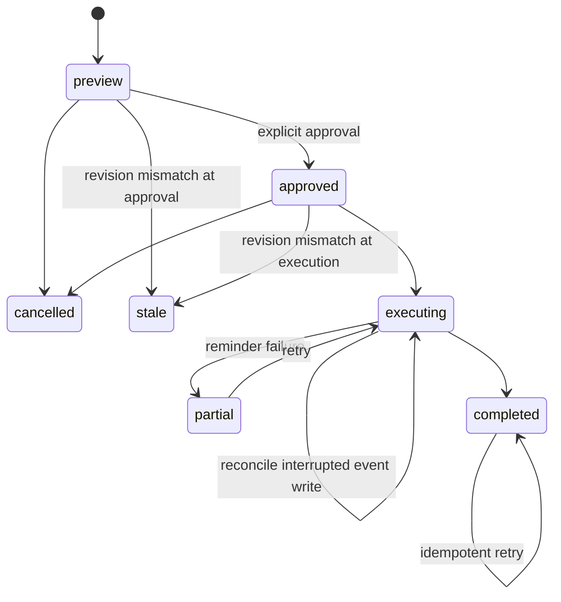

# Architecture and guarantees

## Model boundary

ApplePlanner creates a fresh session for each request. Input is capped at 1,000
characters and the selected day's schedule at 32 busy intervals. Intervals from
other days are excluded; overnight intervals that overlap the day are included.
The tool exposes timestamps,
not event titles or arbitrary calendar notes, and accepts at most three calls.
Tool use is optional: the extraction task does not require schedule retrieval.
All planning and revision checks use the actual application snapshot regardless
of the model's tool decisions. The model has no executor reference.

The selected day and timezone are supplied explicitly. The generated schema can
represent only title, duration, earliest start, latest finish, and reminder lead.
Instructions require clarification for extra constraints or ambiguity. This is
an intended model behavior, not a formally enforced semantic guarantee. Users
must review all extracted details. There is no automatic approval.

## Planner

Validate fields even after Codable decoding. Construct window boundaries using a
Gregorian/user calendar and local wall-clock time rather than adding elapsed
hours to midnight. Sort busy intervals, advance past overlaps, and select the
earliest fitting slot. Duration is elapsed time; window boundaries are wall-clock
times. The candidate start leaves the reminder lead plus one minute for review
after `now`. This avoids rejecting an entire window merely because its first
possible reminder has passed. Normal overlap checks still apply after adjustment.
If the adjusted block cannot fit before the latest finish, no slot is returned.

Nonexistent DST wall times use strict matching and are rejected when matching
moves outside the selected day. Repeated times select the first occurrence.
The UI displays the planning timezone identifier; a timezone change after a
preview does not reinterpret its stored absolute dates.

## Lifecycle

Proposal action fields are immutable in the API. Approval changes only the
proposal state, and does not write an event. The executor accepts approved,
partial, or interrupted executing proposals. A completed proposal returns its
saved receipt. A cancelled proposal is terminal.

## Persistence and reconciliation

A single actor serializes journal mutations without awaiting external operations
inside a transaction. State is encoded to a private sibling file, then atomically
renamed. In-memory state changes only after persistence succeeds. Journal files
have mode 0600. Corrupt or unknown-version journals fail closed.

Event and reminder effects use `proposalID:event` and `proposalID:reminder` keys.
An event effect and the corresponding busy interval are persisted together.
Its execution receipt is saved separately. A deliberate fault between those
writes models the crash gap. On restart the saved effect is found and reused.

After the event exists, retry completes only its approved reminder. It does not
re-plan or create another event. New proposals become stale after an event is
added because the snapshot revision changes.

This is a sandbox-specific guarantee. Side effects and the journal live in the
same local store, and there is no independently failing external service.
An EventKit implementation must discover external writes and reconcile unknown
outcomes before retrying. It cannot inherit an exactly-once claim from these tests.

## Deliberate limits

One journal instance per process; no coordination across multiple app processes.
Atomic replacement is not fsync-backed power-loss durability. The journal is
not encrypted by this code and is not a security boundary against its owning user.
No automatic rollback of completed operations, no batching across external systems,
and no cancellation after a partial write. The UI offers retry/reconciliation
for partial work so it does not imply that cancelling would undo a saved event.
